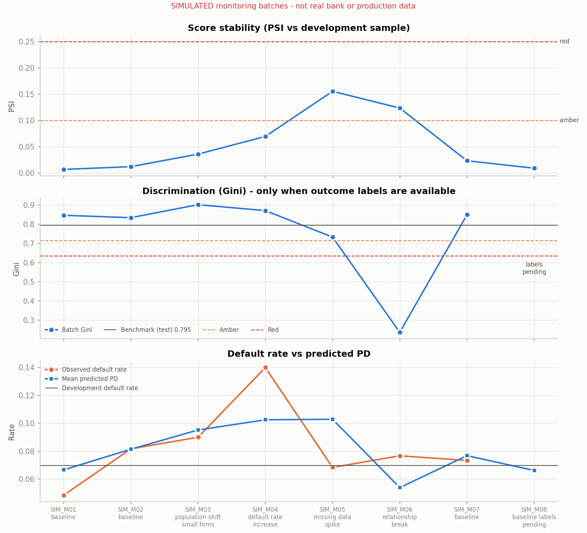
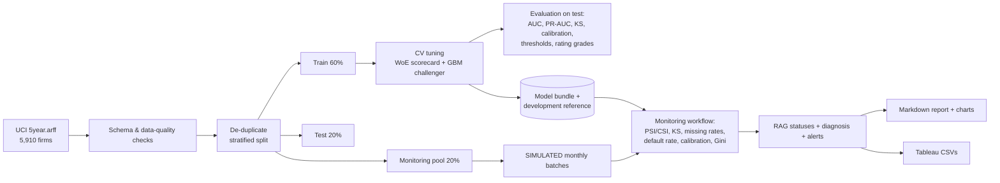

# Credit Risk Modelling & Model Monitoring Pipeline

An end-to-end Python pipeline that builds a **corporate default (PD) model** on public financial-ratio data and then **automates model monitoring**: data validation, score and feature drift, calibration, discrimination, Red/Amber/Green alerts, a Markdown report and **Tableau-ready CSV outputs**, all from one command.

> **Data honesty note.** The model is trained on a real public dataset (UCI *Polish Companies Bankruptcy*). The monthly monitoring batches are **simulated**: they are built by resampling held-out rows and applying documented changes. They are **not** real bank or production data, and every output file carries an `is_simulated` column.

---

## Results at a glance (verified run, seed 42)

| | WoE logistic scorecard (champion) | Gradient boosting (challenger) |
|---|---|---|
| Test ROC-AUC (95% bootstrap CI) | **0.897** (0.855 - 0.933) | **0.939** (0.908 - 0.966) |
| Test Gini | 0.795 | 0.878 |
| Test PR-AUC (base rate 0.069) | 0.583 | 0.742 |
| Test KS | 0.653 | 0.744 |
| Test Brier score | 0.042 | 0.032 |
| Train ROC-AUC | 0.923 | 1.000 (over-fits training data) |

- **The challenger is measurably better.** The paired bootstrap 95% CI for AUC(scorecard) - AUC(challenger) is [-0.071, -0.014], which excludes zero. The scorecard stays the monitored champion because each feature's effect is readable and explainable. The performance gap is reported as a finding, not hidden.
- **Calibration:** the scorecard's mean predicted PD tracks observed default rates across deciles (top decile: predicted 0.393 vs observed 0.436 on the test set).
- **Rank ordering:** observed default rates rise monotonically across the 7 illustrative rating grades on the test set, from 0.4% (G1) to 54.9% (G7).
- **Class imbalance:** `class_weight='balanced'` left scorecard out-of-fold AUC essentially unchanged (0.9133 vs 0.9135) but inflated the mean predicted PD from 0.070 to 0.261 against a 0.070 default rate. The models are therefore trained unweighted, and imbalance is handled through the decision threshold.
- **Monitoring:** across 8 **simulated** batches the pipeline raised 10 alerts and gave each scenario its intended diagnosis (table below).
- **Verification:** 50 automated tests pass. Clean installs on Python 3.11 and 3.12 produced byte-identical model metrics and monitoring outputs.

All of these figures are produced by the code. See `outputs/reports/model_development_report.md` and `outputs/reports/monitoring_report.md`.

### Simulated monitoring scenarios and what the pipeline concluded

| Batch | Simulated scenario | Overall | Automated diagnosis |
|---|---|---|---|
| SIM_M01 | baseline | GREEN | Stable |
| SIM_M02 | baseline | GREEN | Stable |
| SIM_M03 | portfolio tilts to smaller firms | AMBER | Feature drift without performance deterioration |
| SIM_M04 | defaulters drawn at 2x their share | RED | Default-rate shift with ranking intact |
| SIM_M05 | 35% of one model feature goes missing | RED | Data-quality issue (missing-value spike) - likely cause of the calibration breach |
| SIM_M06 | top-2 features shuffled (relationship broken) | RED | Performance deterioration with score drift but no feature-level drift |
| SIM_M07 | baseline | GREEN | Stable |
| SIM_M08 | baseline, outcome labels not yet available | GREEN | Stable on available signals (labels pending) |

SIM_M06 is the key teaching case. Every feature distribution looks stable (all CSI < 0.04), yet Gini falls from a 0.795 benchmark to 0.236. Drift metrics alone would have missed it, which is why outcome-based monitoring is needed once labels arrive.



---

## Architecture



## Repository structure

```
credit-risk-model-monitoring/
├── config/config.yaml          # every threshold, horizon, grid and scenario lives here
├── creditrisk/                 # the Python package
│   ├── data.py                 # UCI loader (downloads if missing), feature dictionary
│   ├── validation.py           # schema + data-quality checks, de-duplication, batch schema checks
│   ├── features.py             # leakage-safe transformers: missing filter, WoE binning, IV/correlation selection
│   ├── train.py                # split, CV tuning, imbalance analysis, evaluation, sensitivity, artefacts
│   ├── evaluation.py           # AUC/Gini/KS/PR-AUC/Brier, thresholds, calibration, rating grades, bootstrap
│   ├── simulate.py             # SIMULATED monitoring batches (scenarios documented in code)
│   ├── monitoring.py           # PSI/CSI/KS, RAG rules, diagnosis, alerts, Tableau CSVs, report
│   ├── plots.py                # charts
│   └── __main__.py             # CLI: validate | develop | simulate | monitor | all
├── data/raw/5year.arff         # UCI file (CC BY 4.0), see DATA_SOURCE.md
├── outputs/
│   ├── reports/                # development + monitoring reports, CSV evidence
│   ├── figures/                # PNG charts generated by the code
│   ├── tableau/                # 6 Tableau-ready CSVs
│   └── model/model_metadata.json
├── tests/                      # 50 pytest tests (unit, end-to-end, real-data checks)
├── docs/                       # runbook, Tableau guide, interview guide, verification log, publishing guide
└── .github/workflows/tests.yml # runs tests + pipeline on every push
```

## Quick start (clean environment)

Requires **Python 3.11 or 3.12**. The pinned scikit-learn 1.5.2 declares support for Python 3.10-3.12, so Python 3.13 and later are not supported targets. Check with `python --version`.

**Windows (PowerShell)**
```powershell
git clone https://github.com/<your-username>/credit-risk-model-monitoring.git
cd credit-risk-model-monitoring
python -m venv .venv
.venv\Scripts\Activate.ps1
pip install -r requirements.txt
python -m creditrisk all
pytest
```

**macOS / Linux**
```bash
git clone https://github.com/<your-username>/credit-risk-model-monitoring.git
cd credit-risk-model-monitoring
python3 -m venv .venv
source .venv/bin/activate
pip install -r requirements.txt
python -m creditrisk all
pytest
```

Individual stages:

| Command | What it does |
|---|---|
| `python -m creditrisk validate` | Data-quality checks only; writes `outputs/reports/data_quality_checks.csv` |
| `python -m creditrisk develop` | Validate, split, tune, evaluate, save the model bundle, reports and charts |
| `python -m creditrisk simulate` | Write the SIMULATED batches to `data/simulated/` |
| `python -m creditrisk monitor` | Monitor every CSV in `data/simulated/` (or `--batch-dir <folder>`) |
| `python -m creditrisk all` | develop, then simulate, then monitor (24-28 s in our Linux test environment; varies by machine) |

**Monitoring your own batch file:** put a CSV with columns `X1`-`X64` in a folder. Optional columns are `default_flag` (outcome labels), `batch_id`, `period_start`, `scenario` and `is_simulated`. Then run `python -m creditrisk monitor --batch-dir <folder>`. Without `default_flag`, the drift checks run and the outcome-based checks are marked `PENDING`.

---

## Methodology

### Data and horizon
- **Source:** UCI Machine Learning Repository, *Polish Companies Bankruptcy* (Tomczak, 2016). It contains 64 financial ratios per firm. Details are in [DATA_SOURCE.md](DATA_SOURCE.md).
- UCI publishes five files, one per forecasting horizon. This project uses **only `5year.arff`**: ratios from the 5th year of the forecasting period, with bankruptcy status **one year later**. A one-year horizon matches the 12-month PD convention in bank credit models. The five files describe different horizons and are deliberately **not merged**.

### Data quality and leakage controls
- **Schema checks** cover the 64 numeric features, a binary target, the documented row and default counts (5,910 and 410, both matched), infinities, constant columns, rows with all features missing, missingness (max 43.1% in X37) and extreme outliers.
- **60 exact duplicate rows are removed before splitting**, so no firm record can sit in both the training and test sets (a test enforces this).
- **X24 is excluded.** UCI documents it as *gross profit (in 3 years) / total assets*, which may contain information from after the observation date.
- **Stratified split:** 60% train / 20% test / 20% monitoring pool. The test set is only used for final evaluation: no hyperparameter, threshold or model choice is tuned on it. The monitoring pool never touches model fitting.
- **Everything learned from data is fitted on training rows only, inside each CV fold:** missing-rate filter, quantile bin edges, WoE values, Information Value and feature selection. Decision thresholds are chosen on out-of-fold training predictions, never on the test set.

### Models
- **Champion: WoE logistic scorecard.**
  - Each ratio is cut into 5 quantile bins, plus a separate bin for missing values.
  - Each bin gets a risk-oriented Weight of Evidence.
  - Features are kept if IV >= 0.02, then filtered by correlation (|r| <= 0.7), up to a maximum of 12.
  - A logistic regression is fitted on the WoE values, with C chosen by 5-fold CV.
  - The model is also expressed as a points-based scorecard (`outputs/reports/scorecard_points.csv`).
  - The 12 selected ratios are X21, X27, X39, X26, X25, X41, X55, X46, X6, X38, X54 and X58.
- **Challenger: HistGradientBoosting.** It uses the raw ratios, handles missing values natively and is insensitive to the extreme outliers in the ratios. Learning rate and depth are tuned by CV.
- **Why two models:** banks typically put an interpretable model into production and keep a stronger "black-box" benchmark. A large gap between the two signals that the scorecard is missing structure.

### Evaluation
- **Metrics:** ROC-AUC, Gini, KS, PR-AUC, Brier score and log-loss, with a 1,000-repetition bootstrap CI and a paired AUC-difference test.
- **Calibration** by predicted-PD decile.
- **Threshold analysis** under explicit, illustrative cost assumptions: missing a defaulter costs 10, an unnecessary review costs 1.
  - Cost-optimal threshold 0.12: recall 0.69, precision 0.39, 12.3% of firms flagged.
  - F1-optimal threshold 0.37: recall 0.41, precision 0.69.
  - Fixed 0.5 threshold: recall 0.30.
- **Rating grades:** an illustrative 7-grade master scale, with a per-grade binomial test.
- **Sensitivity:** removing X21 lowers test AUC from 0.897 to 0.877. X21 has a very high IV (2.34), and 61 of the 63 training firms with missing sales growth defaulted.

### Monitoring
| Check | Metric | Amber | Red |
|---|---|---|---|
| Score stability | PSI of predicted PD vs development sample (10 quantile bins + missing bin) | >= 0.10 | >= 0.25 |
| Feature stability | CSI per model feature; KS test reported for information | >= 0.10 | >= 0.25 |
| Data quality | Increase in missing rate vs development | >= 5 pp | >= 15 pp |
| Default rate | Batch default rate / development default rate (either direction) | >= 1.5x | >= 2.0x |
| Calibration | Two-sided binomial test, observed defaults vs mean predicted PD | p < 0.05 | p < 0.01 |
| Performance | Relative Gini drop vs test-set benchmark (needs labels and >= 15 defaults) | >= 10% | >= 20% |

All thresholds are in `config/config.yaml`. The diagnosis logic keeps four questions separate:
- **Feature drift:** do the inputs look different?
- **Target-distribution change:** did the default rate or calibration move?
- **Performance deterioration:** does the model rank defaulters worse?
- **Data quality:** is a data problem the likely cause of the above?

### Tableau outputs (`outputs/tableau/`)
| File | Grain | Use |
|---|---|---|
| `tableau_batch_summary.csv` | one row per batch | KPI tiles, status table, trend lines |
| `tableau_metrics_long.csv` | batch x metric | one chart for any metric with its amber/red thresholds |
| `tableau_feature_drift.csv` | batch x feature | CSI heatmap, KS, missing-rate changes |
| `tableau_grade_monitoring.csv` | batch x grade | grade migration and default rate by grade |
| `tableau_score_distribution.csv` | batch x score bin | reference vs current score distribution |
| `tableau_alerts.csv` | one row per alert | alert log with recommended actions |

Step-by-step dashboard instructions are in [docs/TABLEAU_GUIDE.md](docs/TABLEAU_GUIDE.md). No Tableau workbook is included in this repository.

## Testing and verification

`pytest` runs 50 tests:
- **Data validation:** schema failures, duplicates, conflicting labels, infinities.
- **WoE transformer:** IV ranking, risk-oriented sign, missing bin, unseen-missing handling, no refitting at transform, correlation filter.
- **Metrics:** Gini/KS edge cases, confusion counts, cost arithmetic, grade boundaries.
- **Monitoring statistics:** PSI properties, RAG boundaries, all diagnosis branches.
- **End-to-end:** a pipeline run on synthetic data covering output files, simulated labelling, pending-label handling, drift scenarios, schema rejection and reproducibility.
- **Real-data checks:** UCI counts, disjoint splits, no shared firm records across train and test.

Full results: [docs/VERIFICATION.md](docs/VERIFICATION.md).

## Limitations
- The data covers Polish companies, 2000-2013. Bankrupt and surviving firms were sampled over different periods, so some signals (notably missing prior-year sales, X21) may partly reflect data collection rather than credit risk. All 12 selected features have IV > 0.5, which is unusually high for credit data.
- There are no dates or firm identifiers, so out-of-time validation is not possible.
- Bankruptcy is used as the default definition; bank definitions (e.g. 90+ days past due) differ.
- Monitoring batches are simulated by resampling 1,170 held-out rows with replacement, so batches can share rows. Real monitoring would use new observations over time.
- The cost ratio, rating master scale and RAG thresholds are illustrative, common industry-style choices, not any bank's policy.
- The challenger over-fits its training data (train AUC 1.000) even though its test performance is strong. It is a benchmark, not a production candidate.

## Data attribution
Tomczak, S. (2016). *Polish Companies Bankruptcy* [Dataset]. UCI Machine Learning Repository. https://doi.org/10.24432/C5F600. Licensed under CC BY 4.0. The original paper describing the data is Zięba, Tomczak & Tomczak (2016), *Expert Systems with Applications*.

## Author
Shivansh Khanna, B.E. (Hons.) Mechanical Engineering and M.Sc. (Hons.) Chemistry, BITS Pilani.

Code licensed under the MIT License (see `LICENSE`). The dataset remains under CC BY 4.0.
