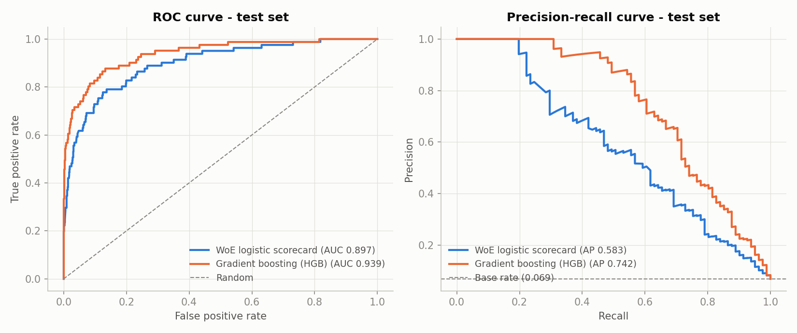
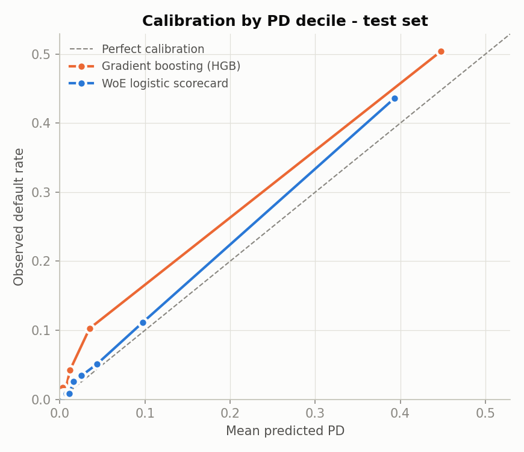
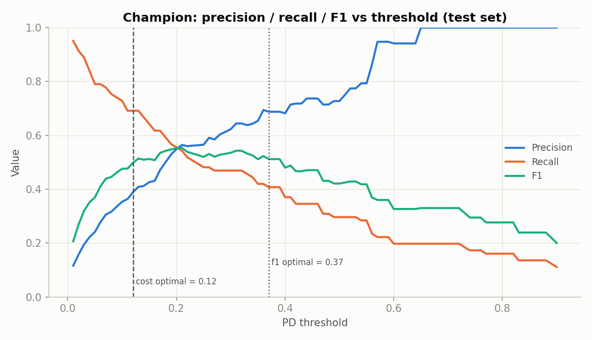
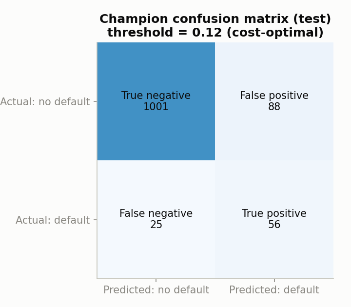
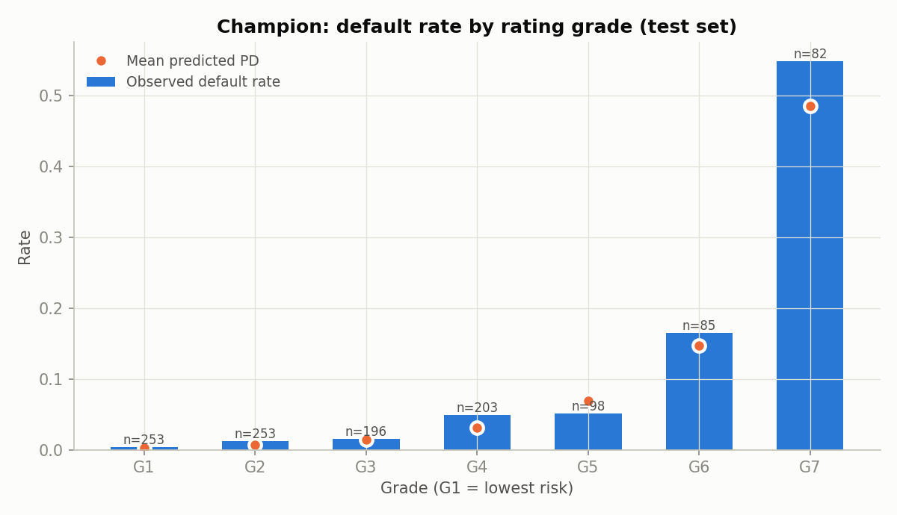

# Model Development Report

_Generated automatically by `python -m creditrisk develop`. All numbers below come from this run._

## 1. Data

- Source: UCI Machine Learning Repository, *Polish Companies Bankruptcy* (Tomczak, 2016), DOI [10.24432/C5F600](https://doi.org/10.24432/C5F600), CC BY 4.0.
- File used: `5year.arff`: financial ratios from the 5th year of the forecasting period, label = bankruptcy status **after 1 year** (12-month horizon). The five horizon files are not merged.
- SHA-256 of the file used: `cb3f6f250ac46bd8d18e9a222f489fe8ee3e396fcec18959f5a0ef8e8169b2fc`
- Rows: 5910 loaded; 60 exact duplicates and 0 conflicting-label rows removed; 5850 used.
- Excluded as a leakage precaution: ['X24'] (documented as gross profit *in 3 years* / TA).

### Data-quality checks

| check | status | value | detail |
|---|---|---|---|
| schema_required_columns | PASS | 0 | X1..X64 and target present |
| schema_numeric_features | PASS | 0 | all 64 features numeric |
| target_binary | PASS | [0, 1] | target must be 0/1 with no missing values |
| row_count | PASS | 5910 | expected 5910 (UCI documentation) |
| default_count | PASS | 410 | expected 410 (UCI documentation) |
| default_rate | PASS | 0.0694 | share of bankrupt firms; informs class-imbalance handling |
| exact_duplicate_rows | WARN | 60 | removed before splitting so copies cannot sit in both train and test |
| duplicates_with_conflicting_labels | PASS | 0 | identical features but different labels (dropped entirely if present) |
| infinite_values | PASS | 0 | inf values are converted to missing |
| rows_all_features_missing | PASS | 0 | rows with no usable feature values |
| high_missing_columns | PASS | 0 | no column above 50% missing (max 43.1%, X37) |
| rows_with_any_missing | PASS | 0.4871 | missing values are kept and handled inside the model pipelines |
| constant_columns | PASS | 0 | [] |
| extreme_outlier_cells | WARN | 397 | cells far outside the 1%-99% range; models use quantile bins / trees, which are robust to them |

### Split (stratified, seed 42)

| split | rows | defaults | default_rate |
|---|---|---|---|
| train (development) | 3510 | 245 | 0.0698 |
| test | 1170 | 81 | 0.0692 |
| monitoring pool | 1170 | 82 | 0.0701 |

There is no date or company identifier in the file, so an out-of-time split is not possible. The monitoring pool is held out from all model fitting and is only used to build *simulated* batches.

## 2. Models

- **Champion - WoE logistic scorecard**: quantile binning (5 bins + a missing bin), Weight of Evidence, Information Value >= 0.02, correlation filter |r| <= 0.7, max 12 features, logistic regression. Bins, WoE and selection are fitted inside each CV fold, so no test information is used.
- **Challenger - Gradient boosting (HGB)**: scikit-learn HistGradientBoosting on raw ratios (handles missing values natively; trees are insensitive to the extreme outliers in the ratios).

### Cross-validated tuning (training data, ROC-AUC)

| model | params | cv_auc_mean | cv_auc_std | selected |
|---|---|---|---|---|
| scorecard_lr | {'lr__C': 0.01} | 0.9137 | 0.0184 | False |
| scorecard_lr | {'lr__C': 0.1} | 0.9144 | 0.0179 | True |
| scorecard_lr | {'lr__C': 1.0} | 0.9135 | 0.0180 | False |
| scorecard_lr | {'lr__C': 10.0} | 0.9135 | 0.0180 | False |
| challenger_gbm | {'gbm__learning_rate': 0.05, 'gbm__max_depth': 3} | 0.9383 | 0.0193 | False |
| challenger_gbm | {'gbm__learning_rate': 0.05, 'gbm__max_depth': 5} | 0.9474 | 0.0192 | True |
| challenger_gbm | {'gbm__learning_rate': 0.1, 'gbm__max_depth': 3} | 0.9437 | 0.0159 | False |
| challenger_gbm | {'gbm__learning_rate': 0.1, 'gbm__max_depth': 5} | 0.9459 | 0.0199 | False |

### Scorecard features and coefficients

WoE is risk-oriented (positive = riskier than average), so positive coefficients are expected.

| feature | coefficient | iv | description |
|---|---|---|---|
| X21 | 0.7502 | 2.3371 | sales (n) / sales (n-1) |
| X27 | 0.6140 | 1.6018 | profit on operating activities / financial expenses |
| X39 | 0.1786 | 1.2420 | profit on sales / sales |
| X26 | 0.0305 | 1.2118 | (net profit + depreciation) / TL |
| X25 | 0.2718 | 1.0362 | (equity - share capital) / TA |
| X41 | 0.1570 | 0.9438 | TL / ((profit on operating activities + depreciation) x 12/365) |
| X55 | 0.1670 | 0.9226 | working capital |
| X46 | 0.3682 | 0.7816 | (current assets - inventory) / ST liabilities |
| X6 | 0.0506 | 0.7722 | retained earnings / TA |
| X38 | 0.3117 | 0.6973 | constant capital / TA |
| X54 | -0.0495 | 0.6806 | constant capital / fixed assets |
| X58 | -0.4175 | 0.6580 | total costs / total sales |

## 3. Class imbalance

The default rate is about 7.0%. Out-of-fold results on the training data:

| model | class_weight | oof_roc_auc | oof_pr_auc | brier | observed_default_rate | mean_predicted_pd | recall_at_0.5 | precision_at_0.5 |
|---|---|---|---|---|---|---|---|---|
| scorecard_lr | none | 0.9133 | 0.6136 | 0.0404 | 0.0698 | 0.0696 | 0.3918 | 0.7164 |
| scorecard_lr | balanced | 0.9135 | 0.6118 | 0.1105 | 0.0698 | 0.2614 | 0.7837 | 0.2857 |
| challenger_gbm | none | 0.9465 | 0.7496 | 0.0327 | 0.0698 | 0.0538 | 0.5265 | 0.8269 |
| challenger_gbm | balanced | 0.9432 | 0.7371 | 0.0352 | 0.0698 | 0.0865 | 0.6449 | 0.6930 |

For the scorecard, `class_weight='balanced'` changes out-of-fold ROC-AUC from 0.9133 to 0.9135, but moves the mean predicted PD from 0.0696 to 0.2614 against an observed default rate of 0.0698. Re-weighting mainly shifts probabilities rather than improving ranking, and a PD model must stay calibrated, so the models are trained **unweighted** and imbalance is handled through the decision threshold instead. No resampling (e.g. SMOTE) is used.

## 4. Test-set performance (untouched hold-out)

| model | n | defaults | default_rate | mean_pd | roc_auc | gini | ks | pr_auc | brier | log_loss | auc_ci_low | auc_ci_high |
|---|---|---|---|---|---|---|---|---|---|---|---|---|
| scorecard_lr | 1170 | 81 | 0.0692 | 0.0606 | 0.8974 | 0.7948 | 0.6533 | 0.5826 | 0.0423 | 0.1558 | 0.8554 | 0.9334 |
| challenger_gbm | 1170 | 81 | 0.0692 | 0.0508 | 0.9387 | 0.8775 | 0.7443 | 0.7423 | 0.0321 | 0.1282 | 0.9081 | 0.9660 |

Bootstrap (1000 reps) 95% CI for champion test AUC: [0.8554, 0.9334].

The paired bootstrap 95% CI for AUC(scorecard_lr) - AUC(challenger_gbm) is [-0.0713, -0.0142], which excludes zero: **challenger_gbm** ranks firms measurably better on this test set.

Train vs test AUC: champion 0.9233 vs 0.8974; challenger 1.0000 vs 0.9387 (a large gap indicates over-fitting).

**Why the scorecard is the monitored champion:** each feature's effect can be read from its bins, points and coefficient, which is what credit analysts and model validators need to review. The challenger is kept as a benchmark; if it is materially better, that gap is itself a finding worth escalating (the scorecard may be missing non-linear effects).

## 5. Calibration

Observed default rate vs mean predicted PD by predicted-PD decile (test set):

| model | bucket | n | defaults | mean_pd | observed_dr |
|---|---|---|---|---|---|
| scorecard_lr | 1 | 117 | 0 | 0.0021 | 0.0000 |
| scorecard_lr | 2 | 117 | 1 | 0.0040 | 0.0085 |
| scorecard_lr | 3 | 117 | 1 | 0.0056 | 0.0085 |
| scorecard_lr | 4 | 117 | 1 | 0.0076 | 0.0085 |
| scorecard_lr | 5 | 117 | 1 | 0.0108 | 0.0085 |
| scorecard_lr | 6 | 117 | 3 | 0.0163 | 0.0256 |
| scorecard_lr | 7 | 117 | 4 | 0.0254 | 0.0342 |
| scorecard_lr | 8 | 117 | 6 | 0.0438 | 0.0513 |
| scorecard_lr | 9 | 117 | 13 | 0.0971 | 0.1111 |
| scorecard_lr | 10 | 117 | 51 | 0.3931 | 0.4359 |
| challenger_gbm | 1 | 117 | 0 | 0.0002 | 0.0000 |
| challenger_gbm | 2 | 117 | 1 | 0.0004 | 0.0085 |
| challenger_gbm | 3 | 117 | 0 | 0.0007 | 0.0000 |
| challenger_gbm | 4 | 117 | 0 | 0.0011 | 0.0000 |
| challenger_gbm | 5 | 117 | 1 | 0.0017 | 0.0085 |
| challenger_gbm | 6 | 117 | 2 | 0.0031 | 0.0171 |
| challenger_gbm | 7 | 117 | 1 | 0.0056 | 0.0085 |
| challenger_gbm | 8 | 117 | 5 | 0.0120 | 0.0427 |
| challenger_gbm | 9 | 117 | 12 | 0.0348 | 0.1026 |
| challenger_gbm | 10 | 117 | 59 | 0.4480 | 0.5043 |

## 6. Threshold analysis

**Assumptions (illustrative, not bank figures):** a missed defaulter (false negative) costs 10 units; an unnecessary review of a healthy firm (false positive) costs 1 unit. Thresholds were chosen on **out-of-fold training predictions**, then applied once to the test set.

- Cost-optimal threshold (train OOF): **0.12**
- F1-optimal threshold (train OOF): **0.37**

| rule | threshold | tp | fp | fn | tn | precision | recall | f1 | flag_rate |
|---|---|---|---|---|---|---|---|---|---|
| cost_optimal | 0.1200 | 56 | 88 | 25 | 1001 | 0.3889 | 0.6914 | 0.4978 | 0.1231 |
| f1_optimal | 0.3700 | 33 | 15 | 48 | 1074 | 0.6875 | 0.4074 | 0.5116 | 0.0410 |
| fixed_0.5 | 0.5000 | 24 | 9 | 57 | 1080 | 0.7273 | 0.2963 | 0.4211 | 0.0282 |

A lower threshold catches more defaulters (higher recall) at the price of more false alarms. With a 10:1 cost ratio, the cost-optimal threshold is far below 0.5.

## 7. Rating grades (illustrative master scale)

| grade | n | share | mean_pd | defaults | observed_dr | binomial_p |
|---|---|---|---|---|---|---|
| G1 | 253 | 0.2162 | 0.0032 | 1 | 0.0040 | 0.5567 |
| G2 | 253 | 0.2162 | 0.0071 | 3 | 0.0119 | 0.2683 |
| G3 | 196 | 0.1675 | 0.0144 | 3 | 0.0153 | 0.7624 |
| G4 | 203 | 0.1735 | 0.0315 | 10 | 0.0493 | 0.1543 |
| G5 | 98 | 0.0838 | 0.0693 | 5 | 0.0510 | 0.6885 |
| G6 | 85 | 0.0726 | 0.1468 | 14 | 0.1647 | 0.6450 |
| G7 | 82 | 0.0701 | 0.4851 | 45 | 0.5488 | 0.2700 |

Rank-ordering check: observed default rates should rise from G1 to G7. Grades with few firms give noisy rates, so read the binomial p-values together with the counts.

## 8. Sensitivity: dependence on high-IV features

In scorecard practice an Information Value above about 0.5 is treated as 'suspiciously strong' and worth investigating. Several ratios here exceed that (see `information_value.csv`).

X21: in the training data 63 firms have a missing value and 61 of them defaulted (96.8%). That missing bin contributes 1.43 of X21's total IV of 2.34. Because bankrupt and surviving firms were sampled over different periods, this may partly be a data-collection artefact rather than pure credit signal.

| variant | excluded | test_roc_auc | test_gini | auc_change |
|---|---|---|---|---|
| champion (all features) |  | 0.8974 | 0.7948 | 0.0000 |
| champion without X21 | X21 | 0.8774 | 0.7548 | -0.0200 |

If removing a single feature changes AUC only slightly, the model does not hinge on it. A large drop would mean its performance relies on that one (possibly sampling-driven) signal.

## 9. Limitations

- Polish companies, 2000-2013 data; bankrupt and surviving firms were sampled over different periods (2000-2012 vs 2007-2013), so some patterns (e.g. missing prior-year sales, X21) may partly reflect data collection rather than credit risk.
- No dates or firm identifiers, so no out-of-time or out-of-sample-firm validation is possible.
- Bankruptcy is used as the default definition; bank default definitions (e.g. 90 days past due) differ.
- The cost ratio and rating master scale are illustrative assumptions.
