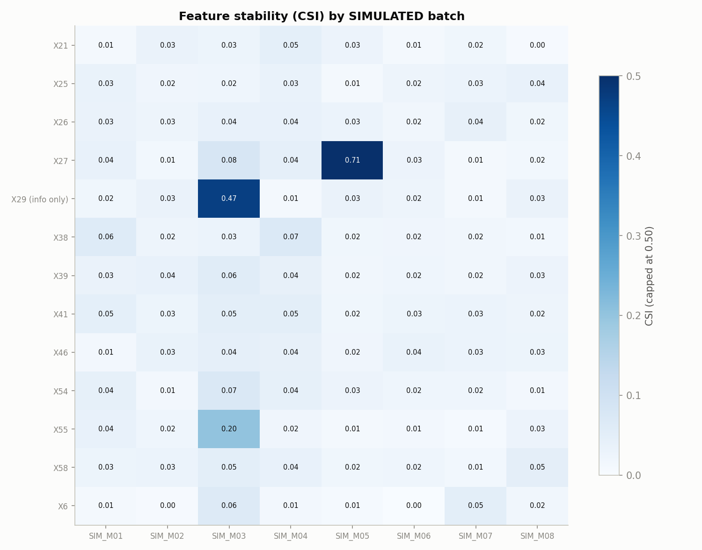

# Model Monitoring Report

_Generated automatically by `python -m creditrisk monitor`._

> **All batches in this report are SIMULATED.** They were created by resampling the held-out UCI monitoring pool and applying documented scenario changes. They are not real bank or production data.

- Monitored model: `scorecard_lr` using features ['X21', 'X27', 'X39', 'X26', 'X25', 'X41', 'X55', 'X46', 'X6', 'X38', 'X54', 'X58']
- Reference (development) default rate: 0.0698; benchmark Gini (test set): 0.7948

## Thresholds (config/config.yaml)

| Check | Amber | Red |
|---|---|---|
| Score PSI / feature CSI | >= 0.1 | >= 0.25 |
| Missing-rate increase (abs.) | >= 0.05 | >= 0.15 |
| Default-rate ratio (either direction) | >= 1.5x | >= 2.0x |
| Calibration binomial p-value | < 0.05 | < 0.01 |
| Relative Gini drop vs benchmark | >= 10% | >= 20% |

Performance metrics need outcome labels and at least 15 defaults.

## Scenarios

| scenario | what was simulated |
|---|---|
| baseline | Random resample of the monitoring pool. Expected: stable. |
| population_shift_small_firms | Smaller firms (bottom 40% of X29 = log total assets) are 4x more likely to be drawn. Feature mix changes; the PD-outcome relationship does not. |
| default_rate_increase | Defaulters drawn at twice their pool share (prior shift). Ranking should hold; calibration should break. |
| missing_data_spike | 35% of values in the champion's 2nd-ranked feature set to missing (simulated upstream feed failure). |
| relationship_break | Values of the champion's top-2 features shuffled within the batch: each feature's distribution is unchanged but its link to the outcome is broken (simulated concept drift or data-mapping error). |
| baseline_labels_pending | Random resample with outcome labels removed (1-year outcomes not yet observed). |

## Batch results

| batch_id | period_start | scenario | labels_available | score_psi | max_feature_csi | max_missing_increase | observed_default_rate | mean_pd | calibration_pvalue | gini | gini_relative_drop | overall_status |
|---|---|---|---|---|---|---|---|---|---|---|---|---|
| SIM_M01 | 2027-01-01 | baseline | True | 0.0070 | 0.0625 | 0.0100 | 0.0483 | 0.0665 | 0.0846 | 0.8469 | -0.0655 | GREEN |
| SIM_M02 | 2027-02-01 | baseline | True | 0.0122 | 0.0387 | 0.0087 | 0.0817 | 0.0814 | 0.9405 | 0.8343 | -0.0497 | GREEN |
| SIM_M03 | 2027-03-01 | population_shift_small_firms | True | 0.0361 | 0.2025 | 0.0319 | 0.0900 | 0.0952 | 0.7280 | 0.9023 | -0.1352 | AMBER |
| SIM_M04 | 2027-04-01 | default_rate_increase | True | 0.0697 | 0.0696 | 0.0186 | 0.1400 | 0.1025 | 0.0037 | 0.8713 | -0.0962 | RED |
| SIM_M05 | 2027-05-01 | missing_data_spike | True | 0.1557 | 0.7111 | 0.3136 | 0.0683 | 0.1029 | 0.0046 | 0.7331 | 0.0777 | RED |
| SIM_M06 | 2027-06-01 | relationship_break | True | 0.1238 | 0.0350 | 0.0136 | 0.0767 | 0.0539 | 0.0182 | 0.2356 | 0.7036 | RED |
| SIM_M07 | 2027-07-01 | baseline | True | 0.0234 | 0.0505 | 0.0071 | 0.0733 | 0.0768 | 0.8181 | 0.8498 | -0.0691 | GREEN |
| SIM_M08 | 2027-08-01 | baseline_labels_pending | False | 0.0093 | 0.0483 | 0.0033 |  | 0.0661 |  |  |  | GREEN |

## Status and diagnosis

| batch_id | score_stability_status | feature_stability_status | data_quality_status | default_rate_status | calibration_status | performance_status | overall_status | diagnosis |
|---|---|---|---|---|---|---|---|---|
| SIM_M01 | GREEN | GREEN | GREEN | GREEN | GREEN | GREEN | GREEN | Stable |
| SIM_M02 | GREEN | GREEN | GREEN | GREEN | GREEN | GREEN | GREEN | Stable |
| SIM_M03 | GREEN | AMBER | GREEN | GREEN | GREEN | GREEN | AMBER | Feature drift without performance deterioration |
| SIM_M04 | GREEN | GREEN | GREEN | RED | RED | GREEN | RED | Default-rate shift with ranking intact |
| SIM_M05 | AMBER | RED | RED | GREEN | RED | GREEN | RED | Data-quality issue (missing-value spike) - likely cause of the calibration breach |
| SIM_M06 | AMBER | GREEN | GREEN | GREEN | AMBER | RED | RED | Performance deterioration with score drift but no feature-level drift |
| SIM_M07 | GREEN | GREEN | GREEN | GREEN | GREEN | GREEN | GREEN | Stable |
| SIM_M08 | GREEN | GREEN | GREEN | PENDING | PENDING | PENDING | GREEN | Stable on available signals (labels pending) |

**How to read the diagnosis.** *Feature drift* means inputs look different from development. *Default-rate / calibration shift* means the outcome rate moved and predicted PDs no longer match it. *Performance deterioration* means the model ranks defaulters worse (Gini falls). They can occur independently: a population shift can leave Gini intact, and a broken feature-outcome relationship can lower Gini while every feature distribution looks stable.

## Alerts (10)

| alert_id | batch_id | severity | component | value | detail |
|---|---|---|---|---|---|
| ALERT_001 | SIM_M03 | AMBER | feature_stability | 0.2025 | features: X55 |
| ALERT_002 | SIM_M04 | RED | default_rate | 2.0057 |  |
| ALERT_003 | SIM_M04 | RED | calibration | 0.0037 |  |
| ALERT_004 | SIM_M05 | AMBER | score_stability | 0.1557 |  |
| ALERT_005 | SIM_M05 | RED | feature_stability | 0.7111 | features: X27 |
| ALERT_006 | SIM_M05 | RED | data_quality | 0.3136 | features: X27 |
| ALERT_007 | SIM_M05 | RED | calibration | 0.0046 |  |
| ALERT_008 | SIM_M06 | AMBER | score_stability | 0.1238 |  |
| ALERT_009 | SIM_M06 | AMBER | calibration | 0.0182 |  |
| ALERT_010 | SIM_M06 | RED | performance | 0.7036 |  |

Recommended actions per component are in `outputs/tableau/tableau_alerts.csv` and `docs/RUNBOOK.md`.
